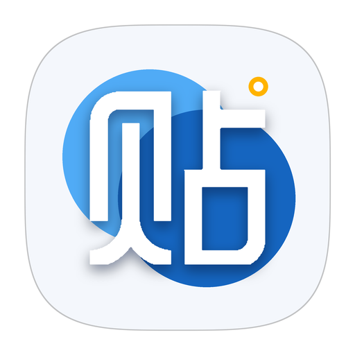
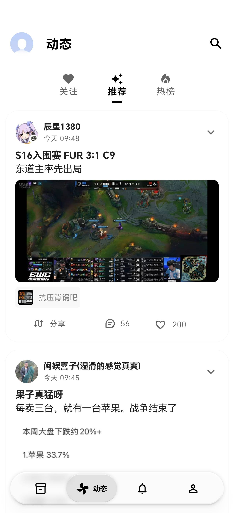
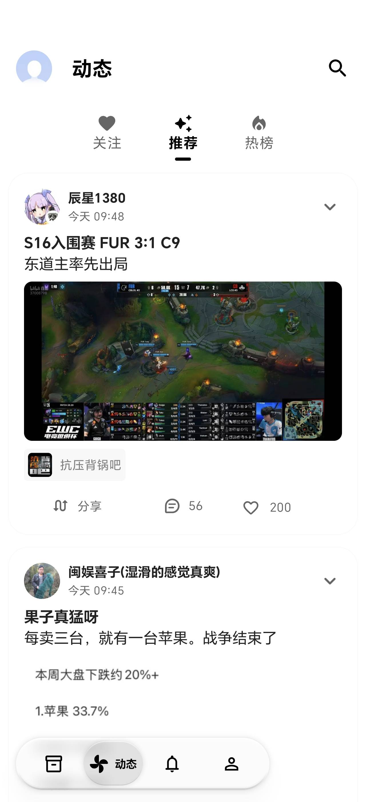

  

<h1 align="center">FluxTie</h1>

  基于 <a href="https://github.com/makise2060/FluxTie">makise2060/FluxTie</a> 上游代码，仅适配<strong>荣耀 AI 随心握</strong>握持优化，并加快应用启动动画。

---

## 🤖 荣耀 AI 随心握适配

荣耀 AI 随心握会根据当前握持方向自动偏移悬浮底栏，避免单手操作时拇指够不到屏幕另一侧的导航按钮。

| 默认居中 | 左手握持 | 右手握持 |
|:---:|:---:|:---:|
|  |  |  |
| 悬浮底栏居中显示 | 底栏向左侧偏移，便于左手拇指操作 | 底栏向右侧偏移，便于右手拇指操作 |

> 论坛页右下角的刷新按钮（FAB）也会同步贴到握持侧并抬高，避免被底栏遮挡；触摸或滑动内容时会快速变淡，松开后柔和恢复。
>
> 非荣耀设备自动跳过该适配，对原版行为零影响。

## 📥 下载

前往本仓库 [**Releases**](https://github.com/funnystyle1991/FluxTie/releases) 下载最新 APK。

## 📄 License

[GPL-3.0](LICENSE) © 原作者及 FluxTie 贡献者

本程序为自由软件，在 GPL-3.0 协议下你可以自由使用、学习、修改与分发。
